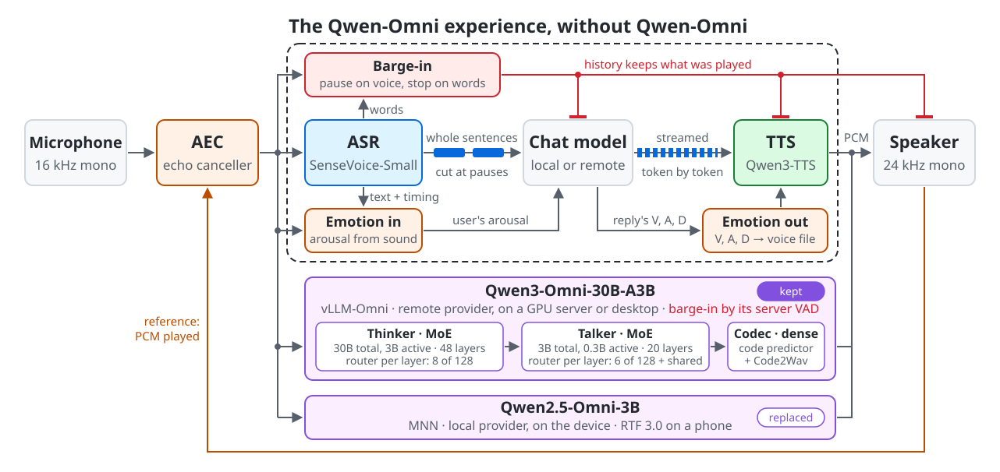

# YoAI

Your conversations live on your device, and models are called with your own API
keys. There is no YoAI account and no YoAI server.

One C++ core with a C ABI, and host apps that link it. This README covers the
core and the desktop client.



## Quick start

### Windows

1. Install Python 3.8+, git, Node 20+ (desktop only), and Visual Studio 2026
   or 2022 with the **Desktop development with C++** workload. Optional, for
   speech output on the GPU: the CUDA Toolkit or the Vulkan SDK.

   Each CUDA compiles only with the Visual Studio versions below. With an older
   CUDA already installed, keep it and use Visual Studio 2022.

   | CUDA Toolkit | Visual Studio |
   |---|---|
   | 13.2+ | 2026, 2022 |
   | 12.4 – 13.1 | 2022 |
   | 12.0 – 12.3 | 2022, version 17.9 or earlier |

   The build uses the newest Visual Studio under Program Files. If it is
   installed somewhere else, or to pick one of several, set `VS_DIR` in `.env`.

2. Build the core and the CLI tools into `build\`:
   ```
   python build.py
   ```
3. Build the desktop app:
   ```
   cd examples\desktop
   python build.py
   ```
   Then run `examples\desktop\dist-win-x64\YoAI.exe`.

### macOS

1. Install the tools with Homebrew, whose installer also sets up the Xcode
   command-line tools and so the compiler (`node` is for the desktop app only):
   ```
   brew install python cmake node git
   ```
2. Build the core and the CLI tools into `build/`:
   ```
   python3 build.py
   ```
3. Build the desktop app:
   ```
   cd examples/desktop
   python3 build.py
   ```
   Then run `examples/desktop/dist-mac-arm64/YoAI.app`.

### Linux

1. Install Python 3.8+, Node 20+ (desktop only), and the compiler and tools;
   on Debian/Ubuntu:
   ```
   sudo apt install build-essential cmake git curl zip unzip tar pkg-config
   ```
   Optional, for speech output on the GPU: the CUDA Toolkit, or Vulkan
   (`sudo apt install libvulkan-dev glslc`).
2. Build the core and the CLI tools into `build/`:
   ```
   python3 build.py
   ```
3. Build the desktop app:
   ```
   cd examples/desktop
   python3 build.py
   ```
   Then run `examples/desktop/dist-linux-x64/yoai`.

The first run downloads vcpkg, llama.cpp and qwentts.cpp into `third/` and
takes a while. Later runs are incremental.

### Then

Chat with a remote model from the shell (`build\yoai-cli.exe` on Windows):

```
build/yoai-cli --base-url https://open.bigmodel.cn/api/paas/v4 --key ... --model glm-4.7-flash
```

Common commands (`python3` on macOS and Linux):

```
# at the root
python build.py --help                 # every option and setting
python build.py clean asr llama tts    # start over with these lanes

# in examples/desktop
python build.py native                 # rebuild only the addon; close YoAI first
python build.py app                    # rebuild only the Electron bundles
npm run dev                            # UI dev loop; needs the addon built once
```

Notes:

- Per-machine paths: copy [.env.example](.env.example) to `.env`.
- On Windows and Linux, speech output runs on CUDA or Vulkan when either is
  installed, else on the CPU. A desktop package built with CUDA only runs
  where the CUDA runtime is installed; set `TTS_BACKEND=vulkan` in `.env` for
  one that runs anywhere.
- Speech output speed, as RTF: seconds of computation per second of speech,
  so below 1 keeps up with playback. Qwen3-TTS `Q4_K_M`; measure your own
  machine with `tests/voice/tts/tts_rtf.py`, and see
  [docs/slides.md](docs/slides.md) for the full table.

  | talker | Kirin 9020 (CPU) | Core Ultra 9 185H (CPU) | Arc iGPU (Vulkan) | RTX 3090 (CUDA) |
  |---|---|---|---|---|
  | 0.6B | 2.61–2.87 | 0.91–0.97 | 0.44–0.45 | 0.10 |
  | 1.7B | 3.15–3.64 | 1.12–1.14 | 0.55–0.57 | 0.11 |

- More: [cli/README.md](cli/README.md) for the CLI tools,
  [examples/desktop/README.md](examples/desktop/README.md) for model files and
  packaging, [examples/python/README.md](examples/python/README.md) for the
  core as a Python package, [examples/server/README.md](examples/server/README.md)
  for the speech server, [third/README.md](third/README.md) for the engine
  checkouts.

## Layout

```
src/                the core: a static library plus a C ABI
  yoai.h              the whole public surface
  llm/                chat and embedding models, on device or remote
  store/              yoai.db: the day timeline and the vectors
  voice/              speech in and out
  utils/              logging, HTTP + TLS, bundles, a memory benchmark
cli/                desktop tools that drive the core from a shell
tests/              one program per test, laid out like src/
tools/              workstation scripts for model files
third/              vendored sources, and where the engine checkouts go
design/             the interface: palettes, icons, logo, and their generators
docs/               what was decided and why: speech, embedding
examples/desktop/   the desktop client (Electron) and its Node-API addon
examples/python/    the core as a Python package (ctypes), built as a wheel
examples/server/    the speech server: text in, speech out, over a WebSocket
```

`examples/harmony/` and `examples/android/` hold the phone hosts; their own
READMEs say how to build them.

## The core is a library

There is no port, no config file and no session state. The host owns settings,
keys and history. It tells the core which models the user has keys for, and
asks it to run a turn:

```c
yoai_provider_set("zhipu/glm-4.7-flash",
                  "https://open.bigmodel.cn/api/paas/v4",
                  api_key, "glm-4.7-flash", NULL);

yoai_chat("zhipu/glm-4.7-flash", messages_json,
          /*system_prompt=*/NULL, /*grammar=*/NULL, on_event, user_data);
```

An on-device model registers with `yoai_local_set` instead, from a GGUF file or
an MNN export directory, and is then used through the same `yoai_chat`.

- **Keys never touch the core's disk.** The registry is process memory, and the
  host fills it again after every start.
- **The host owns history.** `yoai_chat` takes the whole transcript every turn,
  so one place decides what to keep.
- **The core persists only the user's own data:** the day timeline, in a SQLite
  database in a directory the host names.

`yoai_chat` blocks, and streams through a callback on the calling thread.
Returning 0 from the callback cancels the turn. Threads and UI updates are the
host's job, which keeps the ABI small. [src/llm/README.md](src/llm/README.md)
describes how a model is built and where it runs.

## License

MIT; see [LICENSE](LICENSE).
